<!-- Every card is an animated SVG drawn by scripts/render_readme_cards.py and refreshed daily
     by .github/workflows/update-profile-art.yml.
     Spacing is baked into the SVGs, so keep this block free of blank lines. -->

 
 

  <a href="https://theaamirjamadar.vercel.app/">Portfolio ↗</a> &nbsp;&nbsp;·&nbsp;&nbsp;
  <a href="https://www.linkedin.com/in/jamadaraamir/">LinkedIn ↗</a> &nbsp;&nbsp;·&nbsp;&nbsp;
  <a href="mailto:aamirjamadar2007@gmail.com">Email ↗</a>

